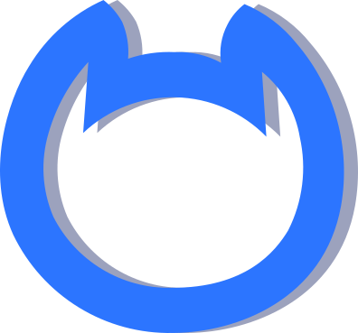
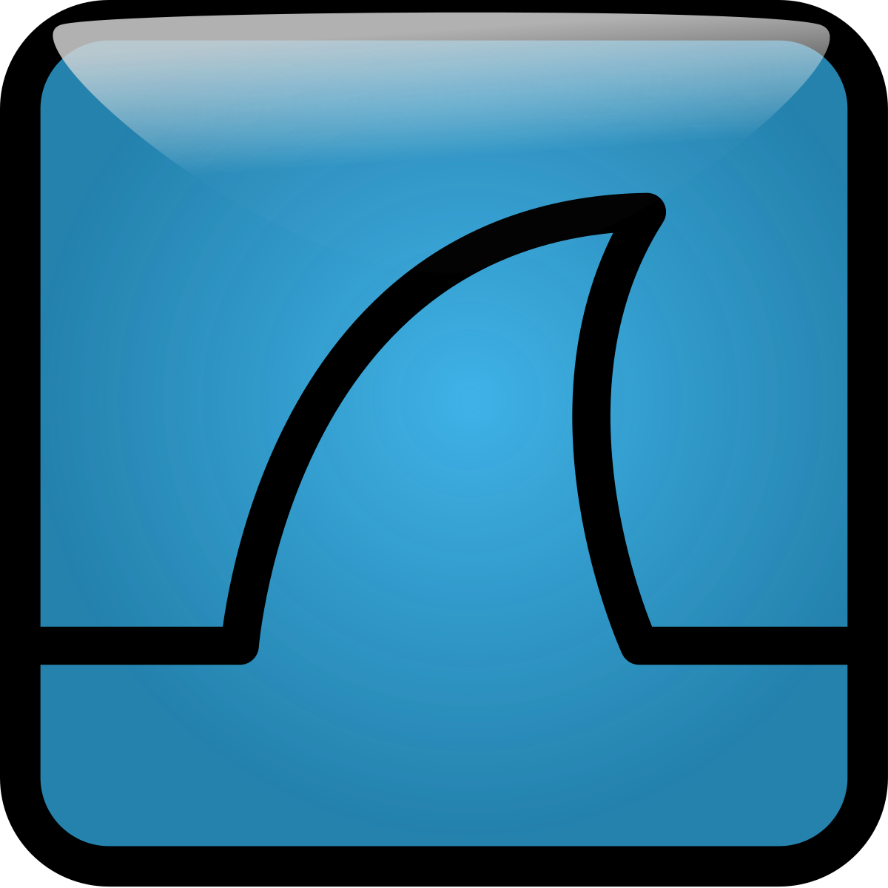
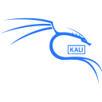
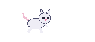

<td width="550" align="center" valign="middle">

  <h2>Cybersecurity · Networking · Ethical Hacking · Linux · SOC · Blue Team</h2>

## whoami

I'm Sidra, an aspiring Cybersecurity Analyst focused on threat detection, vulnerability analysis, and strengthening system security.

- 🔐 Focused on threat detection and defensive security
- 🐧 Skilled in Linux fundamentals, networking, and system security
- 🛡️ Interested in SOC operations, security monitoring, and incident response
- 🧪 Experienced in hands-on labs and Capture the Flag (CTF) challenges
- 🌐 Passionate about identifying vulnerabilities and improving security posture

---

## Languages I know

| Python | C | JavaScript | HTML | CSS | PHP |
|:---:|:---:|:---:|:---:|:---:|:---:|
|  |  |  |  |  |  |

## Cybersecurity tools

<table>
<tr>
<th>Netcat</th>
<th>Nmap</th>
<th>Wireshark</th>
<th>Docker</th>
<th>KaliLinux</th>
<th>BurpSuite</th>
<th>Metasploit</th>
<th>GNS3</th>
</tr>
<tr>
<td align="center" width="100" height="75">

</td>
<td align="center" width="100">

</td>
<td align="center" width="100">

</td>
<td align="center" width="100">

</td>
<td align="center" width="100">

</td>
<td align="center" width="100">

</td>
<td align="center" width="100">

</td>
<td align="center" width="100">

</td>
</tr>
</table>

## Find me around the lab

  
   
  <i>little steps, big packets 🐾</i>

---

  <i>“Learn it. Test it. Secure it.”</i>

